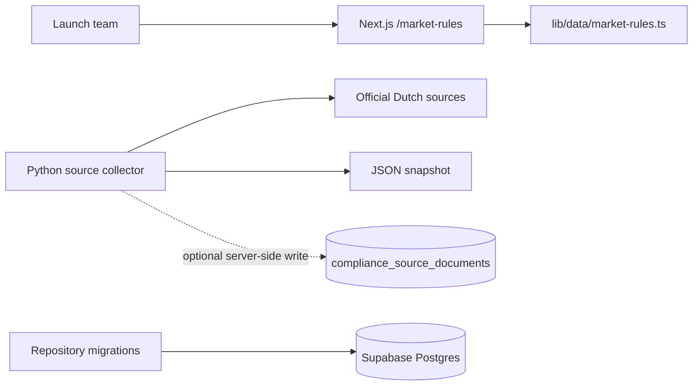
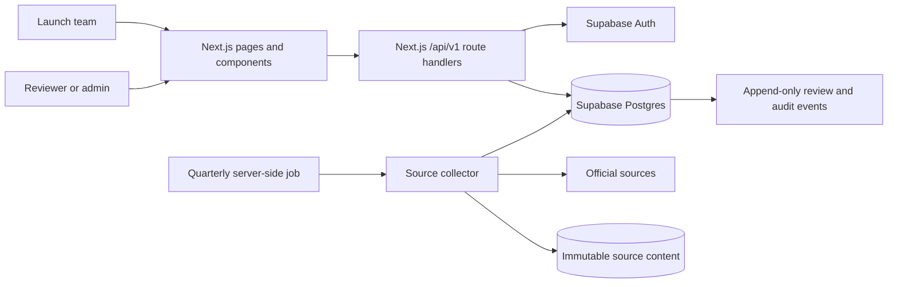

# Architecture

Status: current repository map plus proposed compliance architecture.

Last reviewed: 23 November 2026.

## Purpose

The dashboard gives trawa's Netherlands launch team one view of the rules, processes and market signals needed to enter the Dutch market.

The current user journey is read-only:

1. Open `/market-rules`.
2. Filter Dutch market-rule cards.
3. Open a card to inspect its source, impact and suggested steps.

The planned journey adds reviewed evidence, change review and internal action tracking.

## Current implementation

- Next.js App Router renders the dashboard.
- `app/market-rules/page.tsx` passes local mock records to the client dashboard.
- No Supabase client, route handler or authenticated write path exists yet.
- Python scripts collect official source metadata from BWB, official-publications SRU and ACM.
- The collector writes JSON by default.
- A service-role write to `compliance_source_documents` is optional and server-side only.
- Repository migrations define public-read Row Level Security and no client writes.
- Migration files describe intended database state; this repository does not prove that they have been applied to a live project.

## Proposed compliance architecture

The route-handler boundary is intentional.

- Components consume camelCase DTOs, not database rows.
- Database and collector fields remain server-side.
- Validation, authorization and error mapping happen at the API boundary.
- Review state and audit events change in one database transaction.
- Source collection never publishes a requirement automatically.

The target remains a proposal until its contracts are accepted and the matching routes and migrations exist.

## Data flow

### Dashboard reads

1. The browser requests a Next.js page.
2. The page requests `/api/v1/*` data on the server or through the browser.
3. A route handler validates filters and the session.
4. The route handler queries Supabase.
5. Database rows are mapped to the API DTOs.
6. The UI renders only verified, current, source-backed requirements by default.

### Source collection

1. `config/compliance_sources.json` defines the source scope.
2. The collector retrieves official metadata and source links.
3. Stable hashes make repeated snapshots idempotent.
4. A new source version is stored as immutable evidence.
5. Version comparison creates a pending change, not a legal conclusion.
6. A reviewer confirms or dismisses candidates before publication.

### Writes

Writes are deferred until authentication and roles exist.

- Viewers read published requirements.
- Reviewers decide changes and requirement candidates.
- Reviewers or admins update action items.
- The server resolves the actor from the session.
- Clients never edit quoted source text.

## Module ownership

| Path | Owns |
|---|---|
| `app/` | Routes, layouts and future API route handlers |
| `components/` | Shared dashboard presentation and interaction |
| `lib/data/` | Current UI fixtures only; not a legal data source |
| `lib/` | Future shared DTOs, Supabase access and mapping helpers |
| `config/` | Auditable source-collection scope |
| `scripts/` | Source discovery, retrieval, normalization and optional server-side handoff |
| `supabase/migrations/` | Versioned database schema, constraints, grants and RLS policies |
| `supabase/seed/` | Reviewable seed data; never a live database write |
| `docs/` | Architecture, module intent and company context |
| `docs/contracts/` | Data and API boundaries |

The visual and responsive boundary between presentation and backend integration is defined in `docs/frontend-design-contract.md`.

## Data ownership

- Official authorities own source documents.
- `RegulatoryDocumentVersion` owns the immutable fetched version and its hash.
- `ComplianceRequirement` owns the reviewed obligation shown by the dashboard.
- `RequirementSource` owns the exact citation between a requirement and source version.
- `ActionItem` owns internal operational work.
- Review and audit events own the mutation history.

Do not combine quoted evidence, internal interpretation and task progress in one field.

## Security boundaries

- Supabase tables use Row Level Security.
- Public access is read-only while the product has no edit roles.
- Service-role credentials belong only in scheduled or server-side collection jobs.
- Secrets live in `.env.local` or deployment settings, never in the repository.
- Reviewer identity comes from Supabase Auth, not request JSON.
- Source URLs and check dates are required for displayed regulatory items.
- Failed or unexpectedly empty collection runs do not remove current evidence.

## Deployment

- Vercel hosts the Next.js application.
- Supabase provides Postgres and is the proposed provider for Auth and immutable source storage.
- Repository maintainers apply migrations and seed files.
- Collection is a server-side job; its scheduler, retry policy and exact quarterly timezone are not selected yet.

## Implementation status

| Capability | Status |
|---|---|
| Market-rules dashboard | Implemented with local mock data |
| Source discovery and metadata collection | Implemented as Python scripts |
| `market_rules` migration and seed | Present in the repository |
| Source-document ledger migration | Present in the repository |
| Normalized evidence and review schema | Proposed |
| `/api/v1/*` route handlers | Proposed |
| Supabase Auth and edit roles | Proposed |
| Change review and action-item UI | Proposed |

## Documentation map

- [Market rules module](market-rules.md)
- [Frontend design contract](frontend-design-contract.md)
- [Company context](company.md)
- [Data contract](contracts/data-contract.md)
- [API contract](contracts/api-contract.md)

When implementation and a proposal differ, code and migrations describe current behavior.

The contracts describe the intended boundary and must be updated before implementation changes that boundary.
